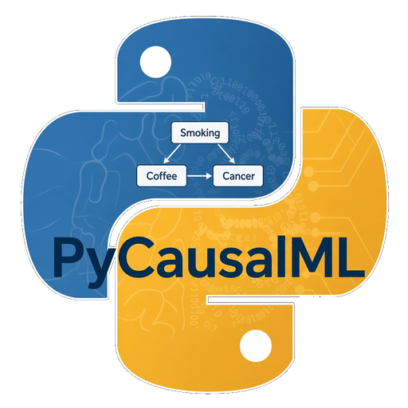

# PyCausalML

<p align="center">
  
</p>

Classical and deep causal inference in one installable package. PyCausalML 0.2.0 **extends [PyDeepCausalML 0.2.0](https://github.com/zia207/PyDeepCausalML/releases/tag/v0.2.0)** and keeps every public estimator from that release (`TARNet`, `DragonNet`, `NOTEARS`, `TCDF`, and the rest). On top of those neural models it adds tree and forest estimators, uplift learners, meta-learners, double machine learning, treatment policies, and Bayesian quasi-experiments. Version 0.2.0 adds `pycausalml.bayesian_causalML`: Bayesian causal networks, structural treatment–outcome models, and structural time series.

The classical modules follow the identifying formulas used by honest causal trees, doubly robust forests, Wald IV forests, uplift splits, S/T/X/R/DR learners, double machine learning, and doubly robust policies. Generalized random forests from [`skgrf`](https://github.com/grf-labs/skgrf) are available when that package is installed. DoWhy, EconML, causal-learn, Uber CausalML, DoubleML, and CausalPy are optional backends in `pycausalml.integrations`.

`import pycausalml` and `import pydeepcausalml` both work after installation. The deep-learning release on its own is still [PyDeepCausalML v0.2.0](https://github.com/zia207/PyDeepCausalML/releases/tag/v0.2.0).

## Contents

- [Installation](#installation)
- [Quick start](#quick-start)
- [Choosing an estimator](#choosing-an-estimator)
- [Classical estimators](#classical-estimators)
- [Deep learning models](#deep-learning-models)
- [Explaining a fitted CATE](#explaining-a-fitted-cate)
- [Optional backends](#optional-backends)
- [Worked examples](#worked-examples)
- [Data, metrics, and checks](#data-metrics-and-checks)
- [Conventions](#conventions)
- [Testing](#testing)
- [References](#references)
- [License](#license)

## Installation

Requires Python ≥ 3.9. PyTorch ≥ 2.0 is included because the deep models are part of this distribution.

From the [v0.2.0 release](https://github.com/zia207/PyCausalML/releases/tag/v0.2.0):

```bash
pip install https://github.com/zia207/PyCausalML/releases/download/v0.2.0/pycausalml-0.2.0-py3-none-any.whl
```

From this repository:

```bash
git clone https://github.com/zia207/PyCausalML.git
cd PyCausalML
pip install -e ".[dev]"
```

Plotting (`matplotlib` / `seaborn`) and the optional libraries:

```bash
pip install -e ".[plot]"
pip install -e ".[dowhy,econml,causallearn,uber,doubleml,causalpy,skgrf,shap,boost]"
```

## Quick start

Classical estimators share `fit(X, treatment, y)` (the RCausalML argument order) and return NumPy arrays of conditional average treatment effects.

```python
from pycausalml import DRLearner, PartiallyLinearDML, synthetic_data
from pycausalml.data import make_linear_treatment

data = synthetic_data(n=1000, p=6, sigma=0.8, mode=2, random_state=0)
dr = DRLearner(learner="gbr", n_estimators=40, random_state=0).fit(data["X"], data["w"], data["y"])
print("CATE:", dr.predict(data["X"][:5]))
print("ATE:", dr.average_treatment_effect())

linear = make_linear_treatment(n=800, tau=2.0, random_state=0)
dml = PartiallyLinearDML(model_y="ridge", random_state=0).fit(linear["X"], linear["w"], linear["y"])
print("DML effect:", dml.effect(), "95% CI:", dml.confidence_interval())
```

Neural estimators use the same top-level import. A short treatment-effect fit:

```python
from pycausalml import DragonNet
from pydeepcausalml.datasets import make_confounded_data

df = make_confounded_data(n=2000, random_state=0)
X = df[["age", "education", "prior_income"]].values
est = DragonNet(epochs=50, random_state=0).fit(X, df["treatment"].values, df["outcome"].values)
print("ATE:", est.predict_ate(X))
```

Longer recipes for discovery, forecasting, and generative models are in [Worked examples](#worked-examples).

## Choosing an estimator

| Question | Reach for |
|---|---|
| Honest tree or forest CATE, with a doubly robust score | `CausalTree`, `CausalForest`, `DRLearner` |
| Uplift on a binary outcome | `UpliftRandomForest`, `UpliftXGBoost`, `qini_curve` |
| Constant effect with a confidence interval | `PartiallyLinearDML`, `InteractiveRegressionDML` |
| Who should be treated? | `PolicyLearner`, `DRPolicyTree` |
| Threshold, before/after, or a single treated unit | `RegressionDiscontinuity`, `DifferenceInDifferences`, `SyntheticControl` |
| Bayesian uncertainty for a quasi-experiment, a causal network, or a structural time series | `bayesian_causalML` |
| Effect of a treatment on i.i.d. data, neural | `TARNet`, then `CFRNet` when representations are imbalanced, then `DragonNet` for a doubly robust fit |
| GAN or VAE individual effects with latent confounding | `GANITE`, `CEVAE` |
| Average treatment effect with a confidence interval | `NeuralDML` |
| Which variables cause which, on static data | `NOTEARSLinear`, `DAGGNN`, `DagmaLinear`, `CASTLE` |
| Which series drives which, and at what lag | `TCDF` (delays), `DynoTEARS` (DAG constraint), `NeuralGrangerCMLP` (fast) |
| What this series would look like under `do(T)` | `CausalLSTMForecaster`, `counterfactual_model("crn")` |
| Latent confounding, with ITEs and propensities | `CausalEGM`, `CausalGAN` |
| Identifiable or causal representations | `IVAE`, `CausalVAE`, `CausalDiscrepancyVAE` |
| Graph neural networks on multivariate series | `GVAR`, `CausalGNN`, `CUTS` |

## Classical estimators

| Module | Estimators |
|---|---|
| `pycausalml.tree_based_models` | `CausalTree`, `CausalForest`, `CausalSurvivalForest`, `InstrumentalForest`, `MultiArmCausalForest`, `CXGBoost`, `BoostedIVForest`, `MultiArmCausalBoost` |
| `pycausalml.uplift_learners` | `UpliftTree` (`kl`, `ed`, `chi`, `cts`, `ddp`), `UpliftRandomForest`, `UpliftXGBoost`, `InteractionTree`, Qini curves |
| `pycausalml.meta_learners` | `SLearner`, `TLearner`, `XLearner`, `RLearner`, `DRLearner`, `DomainAdaptationLearner` |
| `pycausalml.double_machine_learning` | `PartiallyLinearDML`, `LinearDML`, `SparseLinearDML`, `NonParamDML`, `CausalForestDML`, `KernelDML`, `InteractiveRegressionDML` |
| `pycausalml.policy_learners` | `PolicyLearner`, `DRPolicyTree`, `DRPolicyForest` |
| `pycausalml.bayesian_causal_inference` | `BayesianLinearCATE`, `DifferenceInDifferences`, `RegressionDiscontinuity`, `InterruptedTimeSeries`, `InstrumentalVariable`, `SyntheticControl` |
| `pycausalml.bayesian_causalML` | Bayesian DiD, RDD, ITS, IV, and synthetic control; `CausalGraph`, Gaussian and discrete Bayesian networks, `NaiveAdjustmentRegressor`, `NaiveIVRegressor`, `BayesianStructuralSCM`, `BayesianTimeSeriesSCM` |

`bayesian_causalML` does not require PyMC, pgmpy, or CausalNex. Quasi-experimental effects use a Gaussian posterior or a Bayesian bootstrap. Networks implement backdoor and frontdoor identification and `do` interventions. `BayesianStructuralSCM` is the exclusion-restriction model from the [CausalPy structural-model notes](https://causalpy.readthedocs.io/en/latest/knowledgebase/structural_causal_models.html). `BayesianTimeSeriesSCM` rolls a lagged structural model forward under a hard intervention.

```python
from pycausalml.bayesian_causalML import (
    BayesianStructuralSCM,
    BayesianTimeSeriesSCM,
    CausalGraph,
    simulate_structural_scm,
)

data = simulate_structural_scm(n=2000, alpha=3.0, rho=0.6, random_state=0)
scm = BayesianStructuralSCM(random_state=0)
scm.fit(data["X"], data["treatment"], data["y"], instruments=[2, 3], outcome_only=[4])
print(scm.summary())

graph = CausalGraph([("C", "T"), ("C", "Y"), ("T", "Y")])
print(graph.minimal_adjustment_set("T", "Y"))  # ["C"]
```

## Deep learning models

These classes are the PyDeepCausalML 0.2.0 catalog. They import from `pycausalml` and from `pydeepcausalml`.

Recovery checks on simulated data with known ground truth cover `TARNet`, `CFRNet`, `DragonNet`, `NeuralDML`, `NOTEARSLinear`, `DynoTEARS`, `CASTLE`, `NeuralGrangerCMLP`, `TCDF`, `CausalLSTMForecaster`, and `CausalEGM`. Every other public estimator has a short fit-and-predict smoke test that checks output shape and finite values.

### Device support (CPU / GPU / MPS)

Every deep estimator accepts `device=None` (auto-select) or an explicit device string:

```python
from pydeepcausalml import TARNet, resolve_device, get_default_device

print(get_default_device())          # cuda, mps, or cpu
print(resolve_device("cpu"))         # torch.device('cpu')

est = TARNet(device="cuda", epochs=200).fit(X, t, y)   # NVIDIA GPU
est = TARNet(device="mps", epochs=200).fit(X, t, y)    # Apple Silicon
est = TARNet(device="cpu", epochs=200).fit(X, t, y)    # force CPU
```

Auto-selection prefers CUDA, then Apple MPS, then CPU. Acyclicity terms (`matrix_exp`) are always evaluated in float64 on CPU for numerical stability regardless of the training device.

### Treatment effects (`pydeepcausalml.effect`)

| Estimator | Purpose | Key methods |
|---|---|---|
| `TARNet` | CATE via shared representation + two outcome heads | `predict_cate`, `predict_ate`, `predict_potential_outcomes` |
| `CFRNet` | TARNet + MMD representation balancing | same as TARNet |
| `DragonNet` | Propensity head + targeted regularization (doubly robust) | + `predict_propensity` |
| `NeuralDML` | Cross-fitted double ML for the ATE with robust SEs | `predict_ate`, `confidence_interval` |
| `GANITE` | GAN-based individual treatment effect estimation | `predict_cate`, `predict_ate` |
| `CEVAE` | Causal effect VAE with latent confounder | `predict_cate`, `predict_ate` |

### Generative causal models (`pydeepcausalml.generative`)

| Estimator | Purpose | Key methods |
|---|---|---|
| `CausalEGM` | Encoding generative model for ITE/ATE | `predict_ite`, `predict_ate`, `predict_propensity` |
| `CausalGAN` | GAN with structural causal equations | `predict_cate`, `predict_ate` |
| `CausalDiscrepancyVAE` | Discrepancy VAE for causal representation | `predict_cate`, `predict_ate` |
| `IVAE` | Identifiable VAE (auxiliary-conditioned prior) | `transform` |
| `CausalVAE` | Causal VAE with learned DAG over latents | `adjacency_matrix`, `transform` |
| `DSCM` | Deep structural causal model (X → T → Y) | `predict_cate`, `predict_potential_outcomes` |

### Static structure learning (`pydeepcausalml.discovery`)

| Estimator | Purpose | Key methods |
|---|---|---|
| `NOTEARSLinear` | Linear DAG via smooth acyclicity constraint | `get_adjacency` |
| `NOTEARSNonlinearMLP` | Nonlinear NOTEARS with per-node MLPs | `adjacency_matrix` |
| `NOTEARSNonlinearSobolev` | Sobolev-basis nonlinear NOTEARS | `adjacency_matrix` |
| `DAGGNN` | VAE-style DAG-GNN | `adjacency_matrix` |
| `DagmaLinear` | DAGMA linear structure learning | `adjacency_matrix` |
| `DagmaNonlinearMLP` | Nonlinear DAGMA with per-node MLPs | `adjacency_matrix` |
| `DynoTEARS` | Lag-resolved DAG discovery for time series | `get_adjacency`, `get_scores` |
| `CASTLE` | Prediction with causal-structure regularization | `predict`, `get_adjacency` |

```python
from pydeepcausalml import causal_structure_ml, causal_structure_ml_model_descriptions

print(causal_structure_ml_model_descriptions())
est = causal_structure_ml("dagma_linear", device="cuda").fit(X)
A = est.adjacency_matrix()
```

Methods: `notears_linear`, `notears_nonlinear_mlp`, `notears_nonlinear_sobolev`, `dag_gnn`, `dagma_linear`, `dagma_nonlinear_mlp`, `dynotears`, `castle`.

### Time series — Granger causality

| Estimator | Purpose | Key methods |
|---|---|---|
| `NeuralGrangerCMLP` | Component-wise MLPs + group LASSO | `get_adjacency`, `get_scores` |
| `NeuralGrangerCLSTM` | LSTM-based neural Granger | `adjacency_matrix` |
| `NeuralGrangerEconomySRU` | Economy-SRU neural Granger | `adjacency_matrix` |
| `NeuralRelationalInference` | Relational inference for Granger graphs | `adjacency_matrix` |
| `GrangerLSTM` | Full-vs-reduced LSTM ablation Granger test | `get_adjacency`, `get_scores` |

Factory (mirrors R `neural_granger_ml()`): `neural_granger_model("cmlp" | "clstm" | "economysru" | "nri", ...)`.

### Time series — attention, RNN, and GNN

| Estimator | Purpose | Key methods |
|---|---|---|
| `TCDF` | Attention-based temporal causal discovery **with delays** | `discovered_edges`, `summary`, `get_adjacency` |
| `CausalTransformer` | Transformer for temporal causal discovery | `predict`, `causal_matrix` |
| `TFTNet` | Temporal Fusion Transformer causal model | `predict`, `causal_matrix` |
| `CausalLSTM` | Causal LSTM for time-series modeling | `predict`, `causal_matrix` |
| `CausalLSTMForecaster` | Counterfactual multi-step forecasting | `forecast`, `forecast_counterfactual`, `estimate_effect` |
| `RETAIN` | RETAIN attention for interpretable forecasting | `predict`, `causal_matrix` |
| `InterventionAwareRNN` | RNN with explicit intervention encoding | `predict`, `causal_matrix` |
| `GVAR` | Graph VAR for multivariate time series | `causal_matrix` |
| `CausalGNN` | GNN-based temporal causal discovery | `causal_matrix` |
| `CUTS` | Causal discovery from unstructured time series | `causal_matrix` |

### Time series — counterfactual and SCM

| Estimator | Purpose | Key methods |
|---|---|---|
| `DeepSynth` | Deep synthetic control / counterfactual synthesis | `predict_counterfactual` |
| `CRN` | Counterfactual recurrent network | `predict_ite` |
| `GNet` | G-Net counterfactual estimator | `predict_ite` |
| `DeepSCM` | Deep structural causal model for time series | `intervene` |
| `DECI` | Deep end-to-end causal inference | `adjacency_matrix`, `predict_ate` |

Factory (mirrors R `counterfactual_model()`): `counterfactual_model("deepsynth" | "crn" | "gnet", ...)`.

## Explaining a fitted CATE

Every CATE estimator implements `explain` and `plot_shap`. `explain_cate` also accepts a PyDeepCausalML effect model that exposes `predict_cate`. The default explainer is an interventional permutation SHAP and does not require the `shap` package. Pass `method="shap"` to use the `shap` library when it is installed. Plots cover importance, dependence, and a single-row waterfall.

```python
from pycausalml import TLearner, synthetic_data

data = synthetic_data(n=800, p=6, mode=2, random_state=0)
model = TLearner(learner="gbr", n_estimators=50, random_state=0)
model.fit(data["X"], data["w"], data["y"])
explanation = model.explain(data["X"], n_permutations=12)
explanation.plot_importance()
explanation.plot_dependence("X1")
explanation.plot_waterfall(row=0)
```

## Optional backends

`pycausalml.integrations.available_backends()` reports which libraries import. The wrappers call the upstream fitters and raise `ImportError` with the matching install extra when a library is absent:

| Function | Library |
|---|---|
| `dowhy_ate` | [DoWhy](https://github.com/py-why/dowhy) |
| `econml_dml`, `econml_causal_forest`, `econml_drlearner` | [EconML](https://github.com/py-why/econml) |
| `causallearn_pc`, `causallearn_ges`, `causallearn_direct_lingam` | [causal-learn](https://github.com/py-why/causal-learn) |
| `causalml_slearner`, `causalml_tlearner` | [Uber CausalML](https://github.com/uber/causalml) |
| `doubleml_irm`, `doubleml_plr` | [DoubleML](https://docs.doubleml.org/stable/api/api.html) |
| `causalpy_difference_in_differences` | [CausalPy](https://github.com/pymc-labs/CausalPy) |
| `fit_skgrf_causal_forest` | `skgrf` |

## Worked examples

### Treatment-effect estimation

```python
from pydeepcausalml import TARNet, DragonNet, NeuralDML, GANITE, CEVAE
from pydeepcausalml.datasets import make_confounded_data
from pydeepcausalml.metrics import pehe

df = make_confounded_data(n=5000, random_state=0)
X = df[["age", "education", "prior_income"]].values
t, y = df["treatment"].values, df["outcome"].values

est = DragonNet(epochs=200, random_state=0).fit(X, t, y)
print("ATE:", est.predict_ate(X))
print("PEHE:", pehe(df["true_cate"], est.predict_cate(X)))

dml = NeuralDML(n_splits=2, random_state=0).fit(X, t, y)
print("DML ATE:", dml.predict_ate(), "95% CI:", dml.confidence_interval())

ganite = GANITE(epochs=200, device="cuda", random_state=0).fit(X, t, y)
print("GANITE PEHE:", pehe(df["true_cate"], ganite.predict_cate(X)))
```

### Temporal causal discovery with TCDF

```python
import pandas as pd
from pydeepcausalml import TCDF

series = pd.read_csv("my_timeseries.csv")     # one column per series
model = TCDF(kernel_size=4, epochs=1000, random_state=0).fit(series)

print(model.summary())          # cause -> effect with estimated delay
A = model.get_adjacency()       # binary adjacency: A[i, j] means X_j -> X_i
```

TCDF trains an attention-augmented dilated depthwise TCN per target, selects candidate causes from the attention scores, validates each with permutation importance, and reads causal delays off the kernel weights — following Nauta, Bucur & Seifert (2019).

### Causal graph recovery on time series

```python
from pydeepcausalml import NeuralGrangerCMLP, DynoTEARS, causal_structure_ml
from pydeepcausalml.datasets import make_var_data
from pydeepcausalml.metrics import graph_recovery_metrics

X, A_true = make_var_data(n_steps=2000, random_state=0)

cmlp = NeuralGrangerCMLP(lag=5, lambda_group=0.01, random_state=0).fit(X)
dyno = causal_structure_ml("dynotears", lag=5, random_state=0).fit(X)

for name, est in [("cMLP", cmlp), ("DYNOTEARS", dyno)]:
    print(name, graph_recovery_metrics(A_true, est.get_adjacency()))
```

### Counterfactual forecasting

```python
import numpy as np
from pydeepcausalml import CausalLSTMForecaster

# outcome_hist: (units, seq_len), treat_hist: (units, seq_len), future: (units, 12)
model = CausalLSTMForecaster(pred_len=12, random_state=0)
model.fit(outcome_hist, treat_hist, future)

effect = model.estimate_effect(
    outcome_hist,
    factual_treatment=treat_hist,
    counterfactual_treatment=np.ones_like(treat_hist),   # do(T = 1)
)
print("Mean effect over horizon:", effect.mean())
```

### Generative causal models

```python
from pydeepcausalml import CausalEGM, CausalGAN, IVAE, CausalVAE

egm = CausalEGM(epochs=100, random_state=0).fit(X, t, y)
print("ATE:", egm.predict_ate(X))

ivae = IVAE(epochs=100, device="cpu").fit(X, t.reshape(-1, 1))
z = ivae.transform(X[:100])

cvae = CausalVAE(epochs=100, latent_dim=4).fit(X)
print(cvae.adjacency_matrix())
```

### Visualization

```python
import matplotlib.pyplot as plt
from pydeepcausalml.plotting import plot_causal_graph, plot_score_heatmap

fig, axes = plt.subplots(1, 2, figsize=(11, 4))
plot_causal_graph(model.get_adjacency(), node_names=series.columns,
                  delays=model.delays_, ax=axes[0])
plot_score_heatmap(model.get_scores(), node_names=series.columns, ax=axes[1])
plt.show()
```

## Data, metrics, and checks

Support modules:

- `datasets` — synthetic benchmarks with ground truth
- `metrics` — PEHE, ATE error, graph precision/recall/F1/SHD, MASE
- `plotting` — causal graphs, score heatmaps, training curves

Every estimator can be checked on simulated data with known ground truth before it is applied to real data:

```python
from pydeepcausalml.datasets import make_confounded_data, make_var_data, make_intervention_series
```

Effect estimators should recover the known ATE within noise. Discovery methods should score well on `graph_recovery_metrics`. If they do not at your data's scale and noise level, tune before drawing conclusions.

## Conventions

- **Adjacency orientation.** Everywhere in the package, `A[i, j] = 1` means *X_j causes X_i* (rows = effects/targets, columns = causes/sources).
- **sklearn-style API.** Constructors store hyperparameters; `fit` returns `self`; predictions take and return NumPy arrays; `history_` records per-epoch diagnostics; `get_params` / `set_params` are supported.
- **Reproducibility.** Pass `random_state=` to any estimator, or call `pydeepcausalml.set_seed`.
- **Devices.** `device=None` auto-selects CUDA, then MPS, then CPU. Pass `device="cpu"` to force CPU. See [Device support](#device-support-cpu--gpu--mps).
- **Scaling.** Covariates and outcomes are standardized internally by default (`standardize=False` / `standardize_outcome=False` to disable). Predictions are returned in original units.
- **R parity.** Factory functions (`causal_structure_ml`, `neural_granger_model`, `attn_causal_model`, `rnn_causal_model`, `gnn_causal_model`, `counterfactual_model`) mirror the corresponding R `causalDeepNet` entry points.

## Testing

```bash
pytest
```

The suite covers the classical modules (recovery checks on simulated treatment effects, instrumental variables, difference-in-differences, Bayesian networks, structural time series, and SHAP attributions) and every public PyDeepCausalML estimator, plus `datasets`, `metrics`, `plotting`, device selection, and the factory functions (`causal_structure_ml`, `neural_granger_model`, `attn_causal_model`, `rnn_causal_model`, `gnn_causal_model`, `counterfactual_model`).

## References

- Shalit, Johansson & Sontag (2017). *Estimating individual treatment effect: generalization bounds and algorithms.* ICML. (TARNet/CFRNet)
- Shi, Blei & Veitch (2019). *Adapting neural networks for the estimation of treatment effects.* NeurIPS. (DragonNet)
- Athey and Imbens (2016). *Recursive partitioning for heterogeneous causal effects.* PNAS. (honest causal trees)
- Athey, Tibshirani, and Wager (2019). *Generalized random forests.* Annals of Statistics. (causal and instrumental forests)
- Künzel, Sekhon, Bickel, and Yu (2019). *Metalearners for estimating heterogeneous treatment effects using machine learning.* PNAS.
- Nie and Wager (2021). *Quasi-oracle estimation of heterogeneous treatment effects.* Biometrika. (R-learner)
- Chernozhukov et al. (2018). *Double/debiased machine learning.* The Econometrics Journal. (DML)
- Yoon, Jordon & van der Schaar (2018). *GANITE: Estimation of individualized treatment effects using generative adversarial nets.* ICLR. (GANITE)
- Louizos et al. (2017). *Causal effect inference with deep latent-variable models.* NeurIPS. (CEVAE)
- Zheng et al. (2018). *DAGs with NO TEARS.* NeurIPS. (NOTEARS)
- Bello et al. (2022). *DAGMA: Learning DAGs via M-matrices and a log-determinant acyclicity characterization.* NeurIPS. (DAGMA)
- Yu et al. (2019). *DAG-GNN: DAG structure learning with graph neural networks.* ICML.
- Pamfil et al. (2020). *DYNOTEARS: structure learning from time-series data.* AISTATS.
- Kyono, Zhang & van der Schaar (2020). *CASTLE: regularization via auxiliary causal graph discovery.* NeurIPS.
- Tank et al. (2021). *Neural Granger causality.* IEEE TPAMI. (cMLP/cLSTM)
- Nauta, Bucur & Seifert (2019). *Causal discovery with attention-based convolutional neural networks.* MAKE. (TCDF)
- Liu et al. (2022). *CausalEGM: a general causal inference framework by encoding generative modeling.*
- Khemakhem et al. (2020). *Variational autoencoders and nonlinear ICA: A unifying framework.* AISTATS. (iVAE)
- Pearl (2009). *Causality*. Cambridge University Press. (backdoor and frontdoor criteria)
- [pgmpy causal inference](https://pgmpy.org/api/causal_inference.html) (graphical identification and regression estimators)
- [CausalNex](https://github.com/mckinsey/causalnex) (Bayesian networks and interventions; the project was discontinued on 24 June 2026)
- [CausalPy: Bayesian structural causal models](https://causalpy.readthedocs.io/en/latest/knowledgebase/structural_causal_models.html)

## License

MIT — see [LICENSE](LICENSE).
